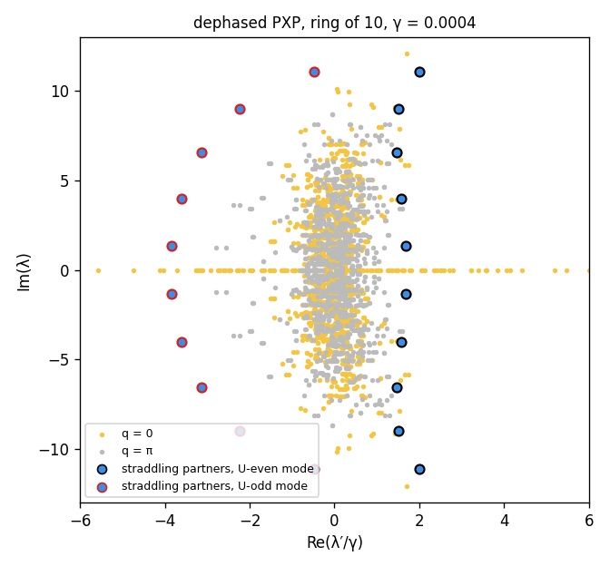
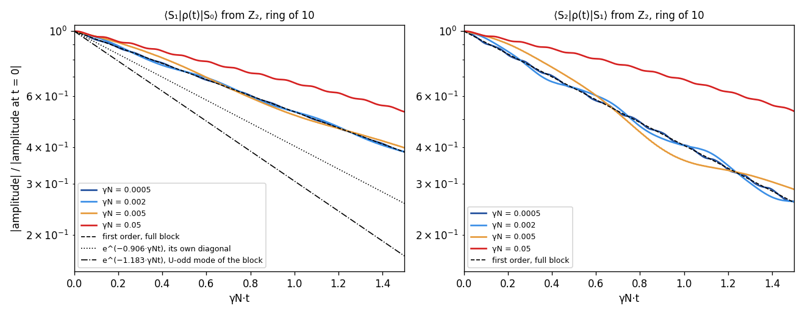

# Scar Coherences and Their Partners: Dephased PXP against a Published Spectrum

**Date:** 2026-11-27
**Authors:** Thomas Wicht, Claude (Opus 5.5)
**Status:** A computed reading held against a published analysis, [Ma, Guo, Gao, Papić and Ying](https://arxiv.org/abs/2504.12291) (arXiv:2504.12291, v3). First order in the dephasing rate with the exact eigenstates of H, on rings of 8, 10, 12 and 14 sites. Second routes: the exact Liouvillian at 8 sites on the blocks of layer 1, of the partners straddling the middle and of |S_2⟩⟨S_0|, and at 10 sites on the middle partners; the propagated revival at 10 sites; the full spectrum at 10 sites and γ = 0.0004 against their Fig. 4(a), read by eye. The reflection they look for is ruled out on the blockaded block by its odd traces, with no eigensolver, exactly on rings of 4 to 300 sites at every positive rate and any coupling; numerically at 6, 8 and 10 sites, at any positive rate, no momentum sector and no sector of momentum and U-parity is mirrored about its own centre. Not typed.
**Script:** [`pxp_scars_under_dephasing.py`](../simulations/pxp_scars_under_dephasing.py); [`output.txt`](../simulations/results/pxp_scars_under_dephasing/output.txt) is a run with `--route2-n10` and `--fig4` (without options about two minutes; these two add the exact checks at ten sites, about an hour); `--traces` runs the odd traces alone, about two and a half minutes, [`traces.txt`](../simulations/results/pxp_scars_under_dephasing/traces.txt)

## What this is about

A chain of Rydberg atoms under the blockade, where no two neighbours may be excited at once, is the PXP model. Started in the alternating pattern 0101…, it keeps coming back to it, because a handful of its eigenstates, its scars, carry nearly all of that pattern and sit at almost equal spacing in energy. Put every atom under dephasing and the returns fade. Ma and co-authors followed what dephasing does to the scars' part of the Liouvillian spectrum: it keeps its pattern far longer than the rest, up to a rate that falls only as one over the length, and they traced that threshold to the competition between dephasing and the scars' weak coupling to the bulk of the spectrum. Their first-order theory approximates the scar states by a large spin built of two-site blocks, in Omiya and Müller's dimerized basis; the decay of the returns they fitted.

The repository's palindrome instruments read the two ends of a Liouvillian's spectrum, the stationary modes and the fastest. How long a coherence lives is read in between, by the Absorption Theorem, which under Z dephasing gives every mode's decay rate as 2γ times its mean number of X and Y letters. This page turns that theorem on the scars.

Every term of PXP flips exactly one atom, so Z on every site turns H into −H and the energy spectrum is symmetric about zero, as Turner and co-authors and Schecter and Iadecola pointed out. Composed with the transpose, this reversal becomes a symmetry of the Liouvillian, U(ρ) = Z⊗N ρᵀ Z⊗N: on a Pauli string it is the sign (−1)^(n_X), and it commutes with the dephased Liouvillian because every Pauli term of PXP carries exactly one X. In Sá, Ribeiro and Prosen's classification this map is P̃ = P·S, for a real H and symmetric jumps; Ccuiro, Fazio and Silva write it as S for PXP under spin flips, sort the alternating state's dynamics by it and write that dephasing would break it. On the scars it gives nearly every coherence between two levels a partner, the coherence between the reflected levels, at exactly the same frequency, and dephasing couples the two. Where the coupling is strong, for one coherence and its partner at every odd multiple of the scars' spacing in frequency, the two split into a slower and a faster combination. A start in any diagonal state, the alternating pattern included, reaches only the U-even combination, and under Z dephasing, to first order and in the span of the two, that one is never the faster: read through the Absorption Theorem, it is the part of the coherence on the Pauli strings with an even number of X letters, which carries fewer X and Y letters wherever the two are coupled. At ten sites and γN = 0.0005 the coherence that carries the middle of the returns decays at about 0.64·γN instead of the 0.91·γN it would have alone.

The two combinations stand in their own Fig. 4(a), read by eye: at the frequencies of the straddling partners, scar eigenvalues lie on two branches, one at the right edge of the bulk and one further left, and the computation here gives the left one no overlap with the alternating state. Ma and co-authors attribute the spectrum's departure from its axes to a missing symmetry 𝒯₋, and their approximate first-order theory, as we read its matrix, splits the partners too; which operator relates PXP's partners they do not say. A symmetry of that kind would mirror the spectrum about its own centre, and every odd moment of the spectrum about that centre would then vanish. The third does not vanish, at any positive rate and any coupling, on rings of 4 and of 6 to 300 sites; on the ring of 5 it vanishes at one ratio of rate to coupling, and there the fifth does not. No eigenvalue is needed to see it: it is a count over pairs of allowed bitstrings, of how far apart they are and of how many atoms each lets the Hamiltonian flip. On the whole space of PXP the same moment vanishes; it is the blockade that makes it nonzero: the complement of an allowed bitstring, every 0 turned into 1 and every 1 into 0, is almost never allowed, and on the whole space it is the complement that keeps the rates symmetric about their mean.

<!-- STAGE 0 SWEEP RECORD (for us, not for the reader: hidden on GitHub, read by every session, agent and hook)

Two survey agents swept the stores by name, one the markdown layer by the physical primitives (the Absorption Theorem, slow modes, first-order rates, exceptional points and spectral transitions, revivals, dark and protected subspaces, towers, Krylov spaces, constrained Hamiltonians, fragmentation, Rydberg, blockade, scar), one the typed and compute layers for instruments that could build dephased PXP and for claims on slow modes and transitions; a third read the paper. Afterwards the K-partnership, the turns of F63 and the stores two review rounds named were read by hand, and the paper's text was searched again here. 
- docs/ANALYTICAL_FORMULAS.md: the Absorption Theorem (entry AT; it gives no rate without the eigenvector); F122's rates 2γ·eig(P_Ω N_XY P_Ω), the same projection on a frequency space, gated on XY and XXZ only; F171's grey room, one rate on an invariant subspace; F141 and F142's ladders that commute with dephasing, the nearest exact tower, XY only; F61, whose n_XY parity is broken by terms of odd n_XY, every PXP term among them, and whose Accessibility Boundary has the shape of this page's selection with the opposite consequence (there a hidden sector can hold a slower mode); F63, under which PXP is odd for the turn by Z⊗N; F119, the transpose as the sign (−1)^(n_Y); F118's cube of characters, θ∘Ad_{Z^⊗N} = (−1)^(n_X), which is U as a sign; the coherence horizon Q* and the clock, single excitations of XY. Nothing on scars, PXP, Rydberg or blockade; "revival" hits another object, the bonding mode's MM(t) under Heisenberg evolution.
- docs/proofs/: PROOF_ABSORPTION_THEOREM (Theorems 1 and 2, the projector form); PROOF_F103_F87_Z2_CUBED_REFINEMENT §7.6, the first-order block by degenerate perturbation theory with Richardson slopes at N = 4 (19 blocks) and N = 5 (101), its §7.1, where a 2-colouring of the graph of H is the chiral K, and its §7.12, where a bipartite basis-state graph makes the spectrum palindromic only beside a lit chiral; PROOF_K_PARTNERSHIP, the sublattice K anticommuting with nearest-neighbour hopping, its Lemma 4 lifting the partnership to the trajectory under real H with Z dephasing, and its scope (on the XXZ chain a single-particle property, kept in the free-fermion limit and broken beyond one excitation by the ZZ term, which commutes with K; a real interacting H that the chiral operator reverses, as PXP is, keeps a partnership of the same kind); PROOF_R90_FROZEN_DIVISOR §9.1, the transpose composed with the bipartite gauge on the XY chain's corner block, its population cells all in U = +1 and never reaching the frozen root; PROOF_PTF_CHIRAL_MIRROR_RATE_LAW, conjugation by the odd-sublattice product chained with complex conjugation giving a trajectory identity for real initial states; PROOF_PALINDROME_COMPLEMENT_CONNECTION, its PXP paragraph (the palindrome on the whole space broken at every N; Turner's scars and Ma and co-authors cited, the question of 𝒯₋ pointed here) and Theorem 2 (one stationary state per component of H's graph on bitstrings); PROOF_WEIGHT1_DEGENERACY, its Lemma 1 for any real symmetric H, its Zeno end and its pointer to Lesanovsky and Garrahan's kinetic constraints; PROOF_STRUCTURAL_CEILING. Nothing on the dynamics of scars.
- experiments/: Z_N_PARTNERSHIP, Z⊗N as a strong symmetry when every term of H and every jump has an even number of X and Y letters, so that conjugation alone carries a state's partner along; PXP's terms have one, the case where conjugation reverses H and the transpose restores a symmetry. F87_WINDOWED_CONVERSE_PER_BLOCK, the block M_ω written out and verified at N = 4; THE_SPREAD_IS_A_RESONANCE, rates spreading inside a block only where the difference spectrum collides, on XXZ blocks; THE_SODIUM_NUCLEUS_TWO_MIRRORS, its bright pairs, among them the satellites, a coherence and its partner under m ↦ −m with ket and bra exchanged, carried into each other by relaxation, for the satellites their sum the slower and their difference the faster (for the double quanta the reverse), detuned by the splitting into an exceptional point, and its sentence that the centre of a pairing is fixed by the trace. "Tower", "Krylov", "revival" and "Néel" hit other objects (F120's moment tower, F157's one-seat space, XY sloshing, initial-state tables). No null result on scars.
- hypotheses/ and reflections/: nothing on scars; reflections/ON_THE_SURVIVAL_OF_THE_INCOMPLETE retells the Zeno end.
- docs/LITERATURE_REVIEW.md, "Related work: closest ancestors": Prosen's PT-symmetric Liouvillians (two papers of 2012) and Sá, Ribeiro and Prosen's classification (2023), the ancestors of the repository's palindrome, among them the two works Ma and co-authors cite for their LPTS ([82], Prosen's PRL of 2012) and their 𝒯₋ ([89]), and its summary of their §II E, the transpose reversing a real H, beside which their P̃ = P·S, the map U, is not named; docs/KMS_DETAILED_BALANCE.md, the negative symmetries of the trace-shifted generator in Sá, Ribeiro and Prosen's convention.
- docs/GLOSSARY.md: the Q book; "palindromic pairing", the sense in which the repository uses the words pair and pairing; nothing on scars or blockade.
- docs/SYMMETRY_FAMILY_INVENTORY.md: the row "K with the transpose", ρ ↦ K·ρᵀ·K with the sublattice K, a linear symmetry of L for real symmetric H; U is the same construction with K = Z⊗N.
- docs/CAUGHT_ERRORS.md: the entry of 2026-11-26 on Theorem 10, whose PXP reason was repaired to the control's vanishing at the complement; an entry naming η-pairing towers as scars, an unchecked pointer; an entry calling the XY sibling ρ ↦ K·ρᵀ·K a symmetry of neither of Buča and Prosen's kinds; this page's own three entries.
- The OpenArcs registry: nothing on PXP, scars, Rydberg, fragmentation or kinetic constraints; "revival" hits another object, a later coherent revival in the arc handshake_decoder.
- fw.Confirmations (simulations/framework/confirmations.py): searched for pxp, scar, rydberg, blockade; nothing.
- The typed layer: AbsorptionTheoremClaim, for any Hermitian H; ChiralKClaim, whose doc names the map U ρ = K ρᵀ K as a symmetry of L for real H; PalindromeComplementConnectionClaim. In Diagnostics/Ptf, ChiralMirrorTrajectoryClaim (the trajectory side of the sublattice chirality) and KPartnerSelectionRuleClaim (a bond defect, odd under K, never couples a single-excitation mode to its K-partner: a matrix element, not this page's rule). The dense readers of Diagnostics (SlowLightDistribution and others) take any dense 4^N Liouvillian, in practice up to six sites; no instrument builds the blockaded space; Core's ComplementConnectionGraph counts the kernels exactly to 30 sites, a count and not a spectrum. LiouvillianBlockSpectrum, MirrorWorld's Restless and Cone and the Python slow_rates workflow are built for number-conserving bonds.
- Outside: Ma, Guo, Gao, Papić and Ying, arXiv:2504.12291 v3, read in full and its text searched here: no "chiral", "particle-hole", "zero mode", "anticommut", "sublattice" or "spectral reflection"; in their Creutz ladder each coherence of a layer is degenerate with a partner, which they attribute to inversion ((S16), supplementary section A4, "Difference between scar subspaces with and without a spectral transition"), and two partners |N − |l| − 2s| steps apart split at that order, along the real axis when it is odd; for PXP one sentence, "the same analysis can be used to prove that the spectral transition only occurs exclusively in 'S,0' subspace", without the proof; their Fig. 4 caption marks local maxima of the overlap with ρ_Z2 by open black circles; their (S58) writes 𝒯₋ for the Creutz ladder as √p_x·[(∏_i σ̂ˣ_i) ⊗ Î]·𝒦, p_x = ±1, and (S41) the same form on block spins in their approximate spin-1 theory for PXP, without the dissipator's quadratic term. Turner and co-authors, Nat. Phys. 14, 745 (2018), arXiv:1711.03528: "The model (1) is particle-hole symmetric: an operator P = ∏_i Z_i anticommutes with the Hamiltonian", each eigenstate at E ≠ 0 with "a partner P|ψ⟩ with energy −E", the graph bipartite by the parity of the number of excitations. Schecter and Iadecola, arXiv:1801.03101: for the constrained Hamiltonian at Δ = 0, the PXP model, "a spectral reflection symmetry generated by C = ∏_i Z_i", every eigenstate |E⟩ with "a chiral partner C|E⟩ = |−E⟩". Turner and co-authors, PRB 98, 155134 (2018), arXiv:1806.10933 v2, Sec. II.B and Appendix A (which cites the Nature Physics paper and Schecter and Iadecola): C = ∏_i Z_i anticommutes with H ("particle-hole symmetry" in their words), each eigenstate at E has a partner at −E, the graph of H is bipartite by the parity of the number of excitations, and its zero modes come from that and inversion. Ccuiro, Fazio and Silva, arXiv:2610.22223 (v1 15 October 2026, v3 2 November 2026): the scar states as |S_m⟩ ∝ P_Em|Z2⟩, the normalized projections of the Néel state onto the eigenspaces of largest weight; the first-order rate of each scar coherence (their Eq. (7)), for coherences of non-degenerate frequency, and in their supplement first order for quasi-degenerate ones in the frequencies only; supplement "Symmetry sectors": S(ρ) = CρᵀC with C = ∏_j σᶻ_j commutes with their Liouvillian (PXP with real jumps odd under C) and the Néel state lies in the sector σ = +1, and they write that dephasing would break S, which a real diagonal jump does not; their supplement's section on large-spin dynamics under dissipation: ⟨H_PXP⟩ vanishes, the precession confined to the (Z, Y) plane.
- For the odd-trace no, a further scout and by hand: F117 in docs/ANALYTICAL_FORMULAS.md and its proof PROOF_F87_WINDOWED_MONOMIAL_CONVERSE, on the whole space recentred at −Nγ, the third moment 6·4^N·γ·Σ_l c_l² for any Hermitian H, needing no cell; F120, the odd moments odd in γ; MirrorWorld's Hardness.OddPowerSums (whole space, floating point), the Sextant's obstructed verdict (an odd trace of L − Tr L/dim over all 4^N strings that is not zero modulo a prime, settings of at most six sites, no block), FluxAreaFifth (cooling and heating, no fields) and the Python twin simulations/framework/diagnostics/odd_traces.py, all on the whole space; F137, the centre of any reflection fixed by the trace; F166 and THE_MIRROR_UNDER_A_SHARED_FIELD, whose Tr Q⁵ = 0 holds because local noise leaves the cell rates symmetric about their mean, the symmetry a covariance breaks, and whose block centres pair a block with its image, not with itself; THE_SODIUM_CHAIN, an invariant block not palindromic about its mean, by its characteristic polynomial over GF(p), not by traces; THE_SODIUM_NUCLEUS_TWO_MIRRORS, odd centred moments of a whole one-spin generator as the no and, for its populations block W, the odd centred power sums about W's own mean rate, polynomials in the spin I that decide the block at every I ≥ 2; PROOF_QUDIT_CLOCK_MIRROR, a rate histogram symmetric about its mean; docs/CAUGHT_ERRORS.md, the two ends counted equal at the trace centre while the multiset does not pair (jumps whose squares are not the identity), and this page's entry of 2026-11-27 on the whole-space break once read as deciding 𝒯₋; PROOF_PALINDROME_TWO_END_COUNT §(f11), whose step 1 splits L into four parts for V the range of a Hermitian far element, a split that holds for any subspace invariant under H and every jump (our reading), the blockaded space among them, while its later steps need the far element, which the blockaded space does not carry; PROOF_MIRROR_ORDER_SORTING, the static cell of its table; the glossary, the OpenArcs registry, the Claim graph and the witnesses: no odd trace of a block about its own centre.
- Our instruments on 4·H, the ring of six sites in the line grammar of MirrorWorld's own-setting modes with the wrap terms written out (the run modes theodolite read, sextant decide and carrier, each with the arguments 6 X:1,ZX:1,XZ:1,ZXZ:1,XIIIIZ:1,ZIIIIX:1,XZIIIZ:1,ZIIIZX:1 1,1,1,1,1,1 Z, and sieve cells 10 X:1,ZX:1,XZ:1,ZXZ:1 Z PXP): theodolite read finds U as a site-local transposed copy and the ring's reflection as a copy after relabelling, and no mirror; sextant decide ends Obstructed by the end count's odd word; carrier reads the end count's upper bounds near 29 and far 0, both exact here (29 components of H's graph on bitstrings); sieve cells reads the cell broken on the ring for every N from 3, by the stitch's no. None of MirrorWorld's instruments takes a given invariant subspace, the blockaded space among them, as its input or reads a block's odd traces, and none splits L by a commuting map it has found; in Diagnostics, SodiumChainWitness reads the characteristic polynomial of L on an invariant block and ConditionedFieldPairingWitness blocks conditioned on a conserved bit, each for its own model.

Checked for adjacency: the block of this page is F87_WINDOWED_CONVERSE_PER_BLOCK's M_ω, F122's projection and the Absorption Theorem's projector form; Ma and co-authors' Eq. (5) with the coefficients (S40) is its analogue for a whole layer of their approximate tower, with a self-energy from the bulk on the diagonal, in a frame shifted by the trace. The map U, the transpose composed with a sign that reverses a real H, with Z⊗N PROOF_F103 §7.1's K for PXP's graph, is built in the repository at these dates, among other places: as the sign θ∘Ad_{Z^⊗N} = (−1)^(n_X) on Pauli strings in F118's cube of characters (PROOF_PI_FACTORS_AS_R_TIMES_D §7, 2026-06-10), the product of F119's transpose and F63's turn by Z⊗N; with complex conjugation in place of the transpose, the two differing by the adjoint that every Liouvillian keeps, in PROOF_K_PARTNERSHIP Lemma 4 (2026-04-25) and PROOF_PTF_CHIRAL_MIRROR_RATE_LAW (2026-06-10, for its trajectory identity), both on the XY chain; with the transpose as a map between blocks in PROOF_CODIM1_BY_ADDITIVITY §7, items (i) and (iv) (2026-07-03); as a symmetry of the XY chain's corner block with the same selection of the populations in PROOF_R90_FROZEN_DIVISOR §9.1 (2026-09-27, the bipartite gauge); relating the odd ring to the ring threaded by a π flux on every diagonal block in PROOF_WEIGHT1_DEGENERACY's Zeno end (2026-10-09); as the linear form on the whole space in ChiralKClaim (2026-11-05) and the inventory's row "K with the transpose" (2026-11-07). In Sá, Ribeiro and Prosen's classification it is P̃ = P·S with p_a = p_b = Z⊗N (arXiv:2212.00474, v1 of 2022-12-01, §II.E.3: for a real H and symmetric jumps a commuting unitary symmetry when p_a and p_b reverse H; Z dephasing meets the wording, Ccuiro, Fazio and Silva's spin flips, real and not symmetric, do not); the repository cites the paper from 2026-03-20 and does not name P̃. For PXP it is Ccuiro, Fazio and Silva's S, in their v1 of 2026-10-15 with the Néel state's sector; the repository names the paper from 2026-11-28, the commit of this page. The sodium page's satellites are the same 2 × 2 of a coherence and its partner. The populations |S_a⟩⟨S_a| and |S_−a⟩⟨S_−a| are partners too; not read here. The odd-trace no against THE_SODIUM_NUCLEUS_TWO_MIRRORS's populations block (the same route on an invariant block, there polynomial in the spin and closed for every spin; joined in the text), against THE_SODIUM_CHAIN's block about its mean (the same question by another route), against the shared field's covariance (the same symmetry of the cell rates, broken by moving the rates where here the kept cells are not closed under the complement), against Theorem 10's control (the same failure of the complement, there breaking the palindrome on the whole space; joined in the text) and against F117's whole-space face (the same moment, zero there for PXP); the selection rule against F131's static cell and F132's dead-set law (the same construction as U with another chiral), both joined in the text.
-->

## The model and the paper's frame

Ma and co-authors' Fig. 4(a) to (c) is computed on a ring of ten sites with H = Σ_j P_(j−1) X_j P_(j+1), coefficient 1, and the dissipator γ·Σ_j (Z_j ρ Z_j − ρ). They write P = (1 − Z)/2, this page (1 + Z)/2; X on every site carries one onto the other and leaves the dissipator alone. The script builds the same model on the blockaded ring of N sites: the bitstrings with no two neighbouring 1s, the ring closed, 47, 123, 322 and 843 of them at N = 8, 10, 12 and 14. In the basis |x⟩⟨y| the dissipator is diagonal: −2γ times the Hamming distance of x and y.

Their real axis is Re(λ′/γ), with λ′ = λ shifted so that the mean of Re λ′ is zero. On the blockaded space that mean is −2⟨Hamming⟩·γ = −N(1 − ⟨z⟩²)·γ, with ⟨Hamming⟩ the mean Hamming distance between two blockaded bitstrings and ⟨z⟩ the mean of Z over them: 6.4029, 8.0005, 9.6001 and 11.2000 times γ at the four sizes, a mean rate of 0.800·γN over all cells |x⟩⟨y| of the blockaded space, populations included. Their Fig. 4(a), read by eye, matches the spectrum computed here with this shift and not with N·γ, and the trace of their dissipator over that of the identity, taken on the blockaded space, is exactly this number: their spectrum lives on the blockaded space, and the zero of their axis is the mean of that spectrum, not the palindrome centre −Nγ of the whole space. The palindrome of dephased PXP is broken at every N in any case, by the control's vanishing at the complement of the pattern it reads (the last paragraph of [the complement connection's Theorem 10](../docs/proofs/PROOF_PALINDROME_COMPLEMENT_CONNECTION.md#theorem-10-a-pairing-bond-under-a-control-of-its-outer-neighbours)); MirrorWorld's [sieve](../compute/MirrorWorld/Sieve.cs), given PXP's four Pauli terms as one cell, reads the same break on the ring for every N from 3, by the stitch's local no.

## The tower and its first order

The [Absorption Theorem](../docs/proofs/PROOF_ABSORPTION_THEOREM.md) holds for every Hermitian H under Z dephasing, PXP included: an eigenvector's rate is 2γ times its mean XY weight, its mean number of X and Y letters. For a coherence |a⟩⟨b| between eigenstates of H it gives, to first order, the rate γ·Σ_j (1 − ⟨Z_j⟩_a⟨Z_j⟩_b); where several coherences share a frequency ω they mix, and the decay rates are −γ times the eigenvalues (all ≤ 0) of the block

  M_ω[(a′,b′),(a,b)] = Σ_l ⟨a′|Z_l|a⟩⟨b|Z_l|b′⟩ − N·δ

over all pairs of eigenvectors at that frequency ([F87_WINDOWED_CONVERSE_PER_BLOCK](F87_WINDOWED_CONVERSE_PER_BLOCK.md), [PROOF_F103 §7.6](../docs/proofs/PROOF_F103_F87_Z2_CUBED_REFINEMENT.md), [F122](../docs/ANALYTICAL_FORMULAS.md)). All rates below are in units of γN.

The tower here is the set of N + 1 scar states, read off the alternating state Z2 = |0101…⟩. S_0 is the projection of Z2 onto the zero-energy eigenspace (dimension 7, 13, 22 and 37 at the four sizes); S_1, S_2, … are walked outward, each the projection onto the eigenspace of largest Z2 weight between 0.5 and 2.0 above the last, and S_−k is the projection onto the eigenspace at −E_k. The N + 1 states carry 0.991, 0.971, 0.942 and 0.906 of Z2. Their ⟨Z_j⟩ is the same on every site, about 0.31 in the middle of the tower and 0.61 at its ends, and their momentum alternates along the tower between 0 and π (S_0 at 0 for N = 8 and 12, at π for N = 10 and 14). A coherence |S_a⟩⟨S_b| lies in layer a − b, at a frequency near a − b times the spacing.

At N = 8 the script checks the blocks of layer 1, of the partners straddling the middle and of |S_2⟩⟨S_0| against the exact Liouvillian at γ = 10⁻⁵ and 10⁻⁴. The real parts at each frequency agree with the block's, and the largest difference grows as (γN)², from 1.9·10⁻⁷ to 1.9·10⁻⁵ in units of γN. On its own a coherence between neighbouring levels |S_(k+1)⟩⟨S_k| would decay at rates from 0.72 at the ends of the tower to 0.91 in the middle (N = 10), against the mean 0.800.

## Every coherence of the tower has a partner

Every term of PXP flips exactly one site, so Z⊗N H Z⊗N = −H: the graph of H on bitstrings is bipartite by the parity of the number of 1s, and the spectrum of H is symmetric about zero: Turner and co-authors noted it when they explained the observed revivals by scars and called it particle-hole symmetry ([Nat. Phys. 14, 745](https://arxiv.org/abs/1711.03528); again in [PRB 98, 155134](https://arxiv.org/abs/1806.10933), Sec. II.B and Appendix A), and Schecter and Iadecola studied it as a spectral reflection symmetry and called C|E⟩ = |−E⟩ the chiral partner of |E⟩ ([arXiv:1801.03101](https://arxiv.org/abs/1801.03101)); a unitary that reverses H is a chiral symmetry in Altland and Zirnbauer's sense, the one [ChiralKClaim](../compute/RCPsiSquared.Core/Symmetry/ChiralKClaim.cs) holds for nearest-neighbour hopping. Z⊗N is the chiral K of that 2-colouring ([PROOF_F103 §7.1](../docs/proofs/PROOF_F103_F87_Z2_CUBED_REFINEMENT.md)). In [PROOF_K_PARTNERSHIP](../docs/proofs/PROOF_K_PARTNERSHIP.md) the sublattice product plays that part for the XXZ chain, where beyond one excitation the partnership survives in the free-fermion limit and breaks at any ZZ interaction, the ZZ term commuting with K; PXP is interacting and keeps it, because Z⊗N reverses every one of its terms and H is real. A bipartite graph does not by itself make the Liouvillian's spectrum palindromic; a lit chiral beside it would (§7.12), and dephased PXP, whose palindrome on the whole space is broken, has none.

H is real and Z⊗N reverses it, and every Z_l is real and commutes with Z⊗N, so the map

  U(ρ) = Z⊗N ρᵀ Z⊗N

commutes with the Liouvillian at every γ. It is the construction of the row "K with the transpose" of [SYMMETRY_FAMILY_INVENTORY](../docs/SYMMETRY_FAMILY_INVENTORY.md) with Z⊗N in place of the sublattice product, the construction [PROOF_R90_FROZEN_DIVISOR §9.1](../docs/proofs/PROOF_R90_FROZEN_DIVISOR.md) uses with the bipartite gauge on the XY chain's corner block. For PXP it is the symmetry S of [Ccuiro, Fazio and Silva](https://arxiv.org/abs/2610.22223), who use it under spin-flip dissipation and write that dephasing would break it; a real diagonal jump, n_j or Z_j, keeps it (derived; the script checks its consequence B = A under dephasing). On a Pauli string U is a sign, [F118](../docs/ANALYTICAL_FORMULAS.md)'s θ∘Ad_{Z^⊗N} = (−1)^(n_X): the transpose gives (−1)^(n_Y) ([F119](../docs/ANALYTICAL_FORMULAS.md)) and the turn by Z⊗N (−1)^(n_X + n_Y) ([F63](../docs/ANALYTICAL_FORMULAS.md)), so U·P = (−1)^(n_X)·P, even on the strings with an even number of X letters. U commutes with the commutator part of the Liouvillian exactly when every Pauli term of H other than the identity has an odd number of X letters, as PXP's terms have one, and with every jump that is a Pauli string. MirrorWorld's [Theodolite](../compute/MirrorWorld/Theodolite.cs), handed 4·H as Pauli strings on the ring of six sites with Z dephasing on every site, reads U by itself, with no eigensolver, as the site-local copy ρ ↦ A·ρᵀ·B with A and B the sign diag(1, −1) on every site, and beside it the ring's reflection, a copy once the sites are relabelled; a site-local mirror, onto −L or onto −L† up to a constant, it does not find.

Z⊗N carries S_k onto (−1)^(N/2)·S_−k exactly, since it carries the eigenspace at E onto the one at −E and Z2 onto (−1)^(N/2)·Z2 (the script checks the modulus of the overlap to 10⁻⁹). So the coherence |S_a⟩⟨S_b| and |S_−b⟩⟨S_−a| have exactly the same frequency, E_a − E_b, and U carries one onto the other. Only |S_a⟩⟨S_−a| is its own partner.

To first order the dissipator couples a coherence χ = |S_a⟩⟨S_b| to its partner U(χ) by c = Σ_l ⟨S_−b|Z_l|S_a⟩², with S_−k taken as Z⊗N S_k: a sum of squares, never negative. In the span of the two, χ + U(χ) decays at χ's own rate minus c/N and χ − U(χ) at its own rate plus c/N (in units of γN): the U-even combination is never the faster, and where c is not zero it is the slower. The Absorption Theorem reads what the two combinations are. U is the sign (−1)^(n_X) on Pauli strings, so χ + U(χ) is twice the part of χ on the strings with an even number of X letters and χ − U(χ) twice the part on the odd ones; the even part carries on average c/2 fewer X and Y letters than χ itself, the odd part c/2 more. At N = 10 the middle coherence |S_1⟩⟨S_0| carries 0.453·N X and Y letters on average, its even part 0.318·N and its odd part 0.588·N, half their rates in units of γN. For a jump that is a Pauli string J in place of Z, the same steps give the coupling the sign (−1)^(n_X(J)) (H real, on the whole space where J leaves the blockaded one; derived here, not computed): under X dephasing the U-even combination would be the faster.

The coupling is the Z matrix element between the levels a and −b, which lie |a + b| steps apart in the tower (Ma and co-authors' word for the same count). The half splitting, in the span of the two:

| N | \|S_1⟩⟨S_0\|, 1 step | \|S_2⟩⟨S_0\|, 2 steps | largest at 3 steps | largest at 4 steps and more |
|---|---|---|---|---|
| 8 | 0.287 | 0.0471 | 3.6·10⁻⁴ | 1.9·10⁻⁴ |
| 10 | 0.270 | 0.0405 | 2.6·10⁻⁴ | 1.2·10⁻⁴ |
| 12 | 0.255 | 0.0359 | 2.1·10⁻⁴ | 7.7·10⁻⁵ |
| 14 | 0.242 | 0.0319 | 1.7·10⁻⁴ | 5.3·10⁻⁵ |

It falls by a factor of 6.1 to 7.6 from one step to two, of 130 to 191 from two to three, and of 1.9 to 3.1 from three to four and more. The number of steps has the parity of the layer, and the levels alternate in momentum, so the partners one step apart sit in the odd layers, at momentum π, and those two steps apart in the even layers, at momentum 0. In its full block the coherence |S_2⟩⟨S_0| lies mostly on a U-odd mode at 0.942 and a U-even one at 0.852 (N = 10). At N = 14 the straddling partners of layer 3 split slightly more than the middle ones (0.246). In every odd layer the partners straddling the middle, |S_(m+1)⟩⟨S_−m| and |S_m⟩⟨S_−(m+1)|, split in the span of the two into a U-even mode between 0.594 and 0.673 and a U-odd mode between 0.786 and 1.194, at all four sizes. For the middle partners themselves, in the full block at their frequency, with the U-parity of each mode computed on the block's eigenvectors:

| N | U-even | U-odd | the share of \|S_1⟩⟨S_0\| on each |
|---|---|---|---|
| 8 | 0.6197 | 1.1967 | 0.498, 0.496 |
| 10 | 0.6328 | 1.1829 | 0.493, 0.489 |
| 12 | 0.6430 | 1.1724 | 0.484, 0.480 |
| 14 | 0.6514 | 1.1639 | 0.473, 0.470 |

The shares fall slowly with N as other members of the block, which grows from 14 to 74 pairs of eigenvectors, take the rest. At N = 10 the exact Liouvillian, by shift-invert at γ = 10⁻⁵, puts the two modes at 0.6328 and 1.1829.

Ma and co-authors work out a mechanism of the same kind for their Creutz ladder, where in their effective description each coherence of a layer but a self-paired one is degenerate with a partner, which they attribute to the ladder's inversion, a flip of every spin on both copies ((S16)), and the dissipator breaks the degeneracy of two partners n steps apart at order n, along the real axis when n is odd (their supplementary section A4); for the scar subspace alone at their N = 3, qubits per leg, their S0 + γD′ without the bulk's self-energy, one mode of the layer l = 1 is the difference of the two partners, each with amplitude 1/√2, without the layer's third coherence ((S54)), and the other two carry each partner with amplitude 1/2 and that coherence with ±1/√2 ((S55)). Their first-order theory for PXP, their Eq. (5) in the form (S28) with the coefficients (S40) in their approximate tower, couples the straddling partners through d⁽¹⁾ and those two steps apart through d⁽²⁾, and so, as we read the matrix, splits them; it does not name the operator relating the partners, the sign of the splitting, or that one mode is invisible from the alternating state. In exact PXP that operator is U, built from Z⊗N, and the Z element joins levels one and two steps apart directly, so the partners one step apart split strongly at first order, those two steps apart weakly, and those three steps apart and more by less than 4·10⁻⁴ of γN (the table). Ccuiro, Fazio and Silva build their tower from the same projections, |S_m⟩ ∝ P_Em|Z2⟩, keeping by their stated rule the N + 1 of largest weight rather than walking outward as here, and give each scar coherence's first-order rate for coherences of non-degenerate frequency (their Eq. (7); under Z dephasing it equals the Absorption Theorem's rate of the coherence); under U every one but |S_a⟩⟨S_−a| has a partner at exactly its frequency, and the coupling to that partner, c under Z dephasing, is what splits the two. The same 2 × 2 stands on the repository's [sodium page](THE_SODIUM_NUCLEUS_TWO_MIRRORS.md): there a satellite coherence and its partner under m ↦ −m with ket and bra exchanged, carried into each other by relaxation, split into a slower sum and a faster difference, and the splitting of the levels detunes them into an exceptional point.

## In their Fig. 4(a)

*The spectrum at N = 10, γ = 0.0004, in their frame, drawn like theirs at momentum 0 and π only (3 033 of the 15 129 eigenvalues, two of them outside the drawn window). Yellow: momentum 0; grey: momentum π. Blue with a black ring: the U-even mode of each set of straddling partners; blue with a red ring: the U-odd mode.*

At their parameters the script takes, for each mode of the straddling partners, the exact eigenvalue nearest its first-order position. In the five odd layers, at Im λ = 1.34, 4.01, 6.58, 8.99 and 11.10, the modes nearest the U-even positions sit at Re(λ′/γ) = 1.68, 1.58, 1.47, 1.52 and 1.99 and those nearest the U-odd ones at −3.83, −3.61, −3.15, −2.24 and −0.48, all at momentum π and all within 0.006 of first order. The overlap of the U-odd modes with ρ_Z2 = |Z2⟩⟨Z2|, the ⟨Z2|·|Z2⟩ component of the normalized right eigenvector, is below 10⁻¹¹, zero to the precision of the eigensolver and exactly zero by U, a U-odd operator having no diagonal component; that of the U-even modes falls from 0.29 to 0.009 up the layers. Their Fig. 4(a), read by eye, has at the same Im λ a column of ringed blue points at about +1.5 to +2, scar eigenvalues at momentum π that their caption marks as local maxima of the overlap with ρ_Z2, and blue points without a ring in an arc from about −4 at the lowest frequency to about −0.5 at the highest. Of that panel they write that the spectrum "is not confined to the real- and imaginary-axes and LPTS is already broken at that point, even for QMBS eigenvalues", with LPTS their Liouvillian PT symmetry, and they attribute this to the missing symmetry 𝒯₋. They cite the first to Prosen (2012) and the second to Sá, Ribeiro and Prosen (2023), two of the three works the repository names as the ancestors of its palindrome ([LITERATURE_REVIEW](../docs/LITERATURE_REVIEW.md)): their question is the palindrome asked on one block, about that block's own trace centre. By position and frequency the arc is the U-odd modes of the straddling partners, and the column the U-even ones.

A symmetry carrying L′ to −L′, as we read their (S57), antilinear as 𝒯₋ is or linear, has its centre at the zero of their axis, since the centre of any such reflection is fixed by the trace (as on the sodium page), and it carries the stationary eigenvalue, at Re(λ′/γ) = +8.0005, onto −8.0005 with the same multiplicity: the necessary half of the repository's two-end count ([F158](../docs/ANALYTICAL_FORMULAS.md)). At N = 10 and γ = 0.0004 the spectrum has one stationary eigenvalue and nothing at the other end; its leftmost eigenvalue lies at −5.59, and the nearest to λ = −2·8.0005·γ lies 2.4·γ away. This confirms at that rate what they state: that the PXP model "manifestly lacks the 𝒯₋ symmetry" and that they "cannot find a 𝒯₋ operator".

The same centre gives a test at every positive rate that needs no eigenvalue. A reflection about the trace centre μ, linear or antilinear, makes every odd power of L′ = L − μ traceless (the spectrum is closed under conjugation, so the antilinear case asks the same of the real traces). Take H = J·Σ_j P_(j−1) X_j P_(j+1) on the blockaded ring; in the basis |x⟩⟨y| the dissipator is −2γ·d(x, y), d the Hamming distance. Of the terms of tr(L′³), the ones with one and with three commutators vanish for every H: the dissipator's diagonal stays when ket and bra are exchanged while the commutator's diagonal, H_xx − H_yy, changes sign, and the differences of the energies come in pairs ±(E_i − E_j). Because H has no diagonal, the diagonal of the double commutator is J²·(f(x) + f(y)), f(x) the number of atoms H can flip in x. With ⟨d⟩ the mean over all ordered pairs of blockaded bitstrings,

  tr(L′³) = −8γ³·a + 6γJ²·b,  a = Σ (d − ⟨d⟩)³,  b = Σ (d − ⟨d⟩)·(f(x) + f(y)),

summed over the pairs, exact rationals; the script checks the form in exact Gaussian rationals at N = 4 to 8. On every ring from 4 to 300 sites but 5, a > 0 > b (by the direct sums up to 14 sites, and up to 300 by the transfer matrix of the pairs, whose integer polynomials equal the direct sums at 4 to 14), so tr(L′³) < 0 at every γ > 0 and every J: the block as a whole has no such reflection at any positive rate. At γ = 0 it has one, the transpose carrying the commutator with a real H to its negative. On the ring of 5, a < 0, and the third trace vanishes on the ray (γ/J)² = 17303/336; there the fifth is −(3294321180/5929)·γJ⁴, exactly. For large N the same transfer matrix gives, per site, a/(n²N) → 18/625 and b/(n²N) → (9 − 5√5)/25 ≈ −0.0872, n the number of blockaded strings, the same signs; past 300 sites the corrections at finite N are not bounded here. Per momentum sector, the frame of their figure, numerically at N = 6, 8 and 10, a > 0 > b about the sector's own centre at every momentum, so at any positive rate no momentum sector is mirrored about its own centre, onto itself or onto the sector at −k, which has the same centre and the same odd traces, real because the ring's reflection, like the adjoint, carries k to −k. Split by U as well, a sector's third trace vanishes, for γ > 0, on at most one ray of γ/J, in three of the eight sectors at N = 6, four of the ten at N = 8 and one of the twelve at N = 10 (k and N − k counted once), and the fifth does not vanish there. Split at k = 0 and π once more by the ring's reflection, for γ > 0 and J ≠ 0 the same holds for every block at N = 8 and for all but one at N = 6: the block of dimension four at k = 0, U even and odd under the reflection, whose third trace vanishes at γ/J = 1/√3, where its four eigenvalues sit at its centre ±0.866·J and ±1.384i·J. Four numbers whose first and third centred power sums vanish are symmetric, so on that one ray this block is mirrored about its own centre. [The sodium page](THE_SODIUM_NUCLEUS_TWO_MIRRORS.md) reads its populations block by the same route, the odd centred power sums about the block's own mean rate; there they are polynomials in the spin I and decide at every I ≥ 2 that the block is palindromic only where its rates vanish, while here they are sums over the powers of a transfer matrix, decided ring by ring.

The no is the blockade's. On the whole space the same third moment, recentred at the palindrome centre −Nγ, is 6·4^N·γ·Σ_l c_l² for any Hermitian H, c_l the coefficient of the single-site string Z_l ([the windowed converse](../docs/proofs/PROOF_F87_WINDOWED_MONOMIAL_CONVERSE.md), the face of [F117](../docs/ANALYTICAL_FORMULAS.md) that needs no cell): its γ³ part vanishes for every H, the rates of the 4^N cells being symmetric about their mean (the number of disagreeing sites is binomial about N/2), and its γJ² part needs a single-site Z term, which PXP does not have. So on the whole space it vanishes. The blockade is a projector built of Z letters alone; it changes no cell's rate, but the set of bitstrings it keeps is not closed under the complement x ↦ x̄: of the blockaded strings only the two Néel patterns have a blockaded complement, and on an odd ring none. The complement of the ket, X^⊗N on one side, carries a cell with k disagreeing sites to one with N − k ([THE_ONE_SQUARE](../docs/THE_ONE_SQUARE.md) §9, the move R), which on the whole space is what makes the rates symmetric about their mean; on the block it carries the cells out of it. What Ma and co-authors write as 𝒯₋ for the Creutz ladder is a move of this kind, √p_x·[(∏_i σ̂ˣ_i) ⊗ Î]·𝒦 with p_x = ±1, a product of σ̂ˣ on one copy of the doubled space composed with complex conjugation ((S58)), which we read as a flip of every spin, the range of the product not being printed; in their approximate spin-1 theory for PXP they write the same form on block spins, for the perturbed Liouvillian of the scar subspace without the dissipator's quadratic term, which they trace to the Rydberg projector ((S41)). On the blockaded space itself the flip of every atom carries every allowed bitstring out of it, but for the Néel pair on an even ring. A set closed under the complement keeps the symmetry (on the half-filling sector the Hamming distance is symmetric about N/2 and a = 0), and the same failure of the complement breaks the palindrome on the whole space, the control of Theorem 10 vanishing at the complement of the pattern it reads. On every ring but that of 5 sites, among the pairs the blockade keeps, the Hamming distance is skewed toward large disagreement (a > 0; per site 18/625 for large N), and on every ring it is smaller where the two bitstrings leave H more to flip (b < 0). Read on the eigen-coherences |a⟩⟨b| of H, where the double commutator is (E_a − E_b)² and the dissipator's diagonal is the Absorption Theorem's first-order rate, J²·b = Σ (E_a − E_b)²·(d̃_ab − ⟨d⟩) with d̃_ab = Σ_l (1 − ⟨Z_l⟩_a⟨Z_l⟩_b)/2: b < 0 says that, to first order and on average weighted by (E_a − E_b)², coherences between levels far apart in energy decay slower than the block's mean. At Ma and co-authors' γ = 0.0004 and J = 1 this term outweighs the γ³ one by about 10⁷ (1.2·10⁷ at N = 8, 1.4·10⁷ at N = 10), so in their figure the no is carried by it. On [the shared-field page](THE_MIRROR_UNDER_A_SHARED_FIELD.md) a covariance breaks the symmetry of the cell rates about their mean by moving the rates; here the noise stays local and the cells the blockade keeps are not closed under the complement.

## The selection rule and the revival

A start whose Pauli strings all have an even number of X letters, any diagonal state among them, is U-even, and since U commutes with the Liouvillian it stays U-even at every time: it never populates a U-odd mode, and every readout odd under U, such as ⟨X_j⟩ or ⟨H⟩, stays zero, the confinement of the precession to the (Z, Y) plane that Ccuiro, Fazio and Silva describe. PROOF_R90_FROZEN_DIVISOR §9.1 states the same selection on the XY chain's corner block, whose populations lie in U = +1, and the trajectory identity of [PROOF_PTF_CHIRAL_MIRROR_RATE_LAW](../docs/proofs/PROOF_PTF_CHIRAL_MIRROR_RATE_LAW.md) comes from the same conjugation. In the table of the repository's order-sorting law ([F131](../docs/proofs/PROOF_MIRROR_ORDER_SORTING.md)) the rule is the static cell of a linear mirror: from a preparation even under a mirror the generator keeps, a readout odd under it is identically zero at all times. [F132](../docs/ANALYTICAL_FORMULAS.md)'s dead-set law reads the kill signs of the same construction on the XY chain in a longitudinal field, W_g·conj(ρ)·W_g† with W_g = U_g·X^⊗N reversing H, which on a Hermitian state is W_g·ρᵀ·W_g†. For the middle partners, at N = 10 from Z2, B(t) = ⟨S_0|ρ(t)|S_−1⟩ equals A(t) = ⟨S_1|ρ(t)|S_0⟩ exactly, the phases of S_0 and S_±1 being those of their projections of Z2; the script finds it to 2·10⁻¹⁴ at every rate it runs. The rule is not the scars' own. What is the tower's own is the large Z element between neighbouring levels, which puts the hidden mode far above the visible one.

The script reads the revival from Z2 at N = 10 on the coherences themselves rather than on the imbalance. At γ = 0 their moduli are constant, 1.0000000000 at t = 300, since the S_k are eigenvectors; whatever PXP's returns lose at γ = 0 drops out, and the decay is the dephasing's alone. The U-even operator |S_1⟩⟨S_0| + |S_0⟩⟨S_−1| lies 0.985 on the slow mode of the middle block and 0.015 on a mode at 0.874.

| γN | slope of −ln\|A\| fitted over γN·t ≤ 1.5 | the same for −ln\|O\| | largest distance of \|A(t)\|/\|A(0)\| from the block's first order |
|---|---|---|---|
| 0.0005 | 0.6361 | 0.9025 | 4.2·10⁻³ |
| 0.002 | 0.6417 | 0.9196 | 1.6·10⁻² |
| 0.005 | 0.6600 | 0.9533 | 3.8·10⁻² |
| 0.05 | 0.4189 | 0.4184 | 1.5·10⁻¹ |

Here O(t) = ⟨S_2|ρ(t)|S_1⟩ is the next coherence out, whose partner lies three steps away and barely couples: at γN = 0.0005 it decays at 0.9025 against its own first-order 0.902. At γN = 0.0005 and γN·t = 1.5 the middle coherence keeps 0.386 of its amplitude (first order 0.385); at its own rate it would keep 0.257. Up to γN = 0.005 the distance of |A| from first order grows roughly in proportion to γN (8.4, 8.2 and 7.6 times γN), and its slow part beats at the detuning of the neighbouring coherence |S_2⟩⟨S_1|: at γN = 0.0005, ln|A| beats about its fitted line at angular frequency 0.025 (the transform resolves 0.002), against a detuning of 0.0253.

*Left: |⟨S₁|ρ(t)|S₀⟩| from Z₂ against γN·t, at four rates, with the block's first order (dashed), the coherence's own diagonal rate (dotted) and the rate of the block's U-odd mode (dash-dotted). Right: |⟨S₂|ρ(t)|S₁⟩| with its block's first order.*

For the middle coherence first order holds at N = 10 to within 0.017 of the block's curve up to γN = 0.002, and for the next one to within 0.032. At γN = 0.05 both decay at about 0.42, slower than either first-order rate, a regime this page does not read.

## What this is, and what it is not

It is a first-order reading with the exact eigenstates of H, on rings of 8, 10, 12 and 14 sites, with the second routes the Status line lists. Under Z dephasing it reads how the partners that U relates split: by a sum of squares, strongly for partners one step apart, to first order and in the span of the two the U-even combination never the faster, which the Absorption Theorem reads as the part of the coherence with an even number of X letters carrying fewer X and Y letters. It shows the straddling partners as the two branches of Ma and co-authors' Fig. 4(a), read by eye at N = 10 and γ = 0.0004, it confirms by the two-end count that their 𝒯₋ does not exist there, and by the odd traces, with no eigensolver, that the blockaded block has no reflection about its centre at any positive rate and any coupling on rings of 4 to 300 sites, nor, numerically at 6, 8 and 10 sites and at any positive rate, any momentum sector or sector of momentum and U-parity about its own, while at 6 sites one block of dimension four, split further by the ring's reflection, is mirrored on one ray; and it reads the revival's middle coherence on its slow mode.

Where it meets other work: Turner and co-authors and Schecter and Iadecola pointed out the operator Z⊗N. The map U, the transpose composed with a sign that reverses a real H, is built in the repository on the XY chain with the sublattice sign, as its antilinear sibling ρ ↦ Kρ*K in [PROOF_K_PARTNERSHIP](../docs/proofs/PROOF_K_PARTNERSHIP.md) Lemma 4 (April 2026, on one excitation) and on one block, with the populations in its even sector, in [PROOF_R90_FROZEN_DIVISOR §9.1](../docs/proofs/PROOF_R90_FROZEN_DIVISOR.md) (September 2026); with Z⊗N it is the sign θ∘Ad_{Z^⊗N} = (−1)^(n_X) on Pauli strings in F118's cube of characters ([PROOF_PI_FACTORS_AS_R_TIMES_D](../docs/proofs/PROOF_PI_FACTORS_AS_R_TIMES_D.md) §7, June 2026), and it is read here as a symmetry of dephased PXP; in [Sá, Ribeiro and Prosen](https://arxiv.org/abs/2212.00474)'s classification (arXiv v1 of 2022, PRX 2023) it is P̃ = P·S, for a real H and symmetric jumps, Z dephasing among them, and Ccuiro, Fazio and Silva write it as S for PXP under spin flips (October 2026), with the projections the tower is built from and the selection of the alternating state. Ma and co-authors work out for the Creutz ladder that the dissipator breaks the degeneracy of two partners n steps apart at order n; in exact PXP partners split at first order at every distance the table reads, strongly only at one step, and their approximate first-order theory for PXP, as we read its matrix, splits the straddling partners too. It does not read their threshold for the scars, their transitions at momentum 0 or their fitted β; it reads the revival on an eigen-coherence, not on the imbalance, and only at N = 10. U is a symmetry of the Liouvillian, U·L = L·U; it is not a palindrome, which would carry L to −L minus a constant, and the palindrome of dephased PXP on the whole space stays broken at every N.

## Open

- The mixed regime: from γN of about 0.002 at N = 10 the fitted slopes leave the full block's first order, by 4 to 6 % at 0.005 and fully at 0.05; and their transitions at momentum 0. A candidate, unchecked: coherences of an even layer that are near in frequency without being partners, such as |S_2⟩⟨S_0| at 2.6617 and |S_1⟩⟨S_−1| at 2.6870 at N = 10, coupled by the large one-step element across a detuning of 0.025. The two combinations of a coherence and its partner lie in different sectors of U, so they can cross but never merge into an exceptional point, and a transition has to happen inside one sector, as it can between |S_1⟩⟨S_−1| and the U-even combination of |S_2⟩⟨S_0| with its partner. A perturbation that breaks U, such as a field along Z, would detune the partners themselves, as the splitting does on the sodium page; not read.
- How the middle coherence's weight on its two modes changes with N, from 0.498 at N = 8 to 0.473 at N = 14 as the block grows; the selection itself is exact at every N.
- The imbalance itself, with PXP's own decay at γ = 0, against their Fig. 5; their numbers are not in the text.
- The open chain, where Z⊗N still reverses H and the tower differs; the deformations of PXP whose scars are nearly exact.
- Other dissipation: U holds for every jump that is a Pauli string and for Ccuiro, Fazio and Silva's spin flips; for jumps that are all one Pauli string the slower combination follows that string's letters (derived above on the whole space, not computed), for spin flips no such rule is derived here.
- The partners among the populations, |S_a⟩⟨S_a| and |S_−a⟩⟨S_−a|.
- The odd-trace no at every N: the per-site limits keep the signs for large N, but the corrections at finite N past 300 sites are not bounded here; the per-sector reading is numerical and stops at 10 sites, the blocks split by the ring's reflection at 8; the whole U-even sector cannot be carried onto the U-odd one, their dimensions being n(n + 1)/2 and n(n − 1)/2, but a reflection carrying one sector of momentum and U-parity onto another of a different centre is not read, only that of the whole block.

## Links

- [Ma, Guo, Gao, Papić and Ying, arXiv:2504.12291](https://arxiv.org/abs/2504.12291), Phys. Rev. Lett. 135, 180401 (2025), the paper held against here; [Turner and co-authors, Nat. Phys. 14, 745 (2018)](https://arxiv.org/abs/1711.03528) and [PRB 98, 155134 (2018)](https://arxiv.org/abs/1806.10933), the scars and C = ∏_i Z_i; [Schecter and Iadecola, arXiv:1801.03101](https://arxiv.org/abs/1801.03101), the spectral reflection and its chiral partners; [Ccuiro, Fazio and Silva, arXiv:2610.22223](https://arxiv.org/abs/2610.22223), the symmetry S = U of a dissipative PXP Liouvillian, the tower and the selection of the Néel state.
- [PROOF_ABSORPTION_THEOREM](../docs/proofs/PROOF_ABSORPTION_THEOREM.md), the rate of an eigenvector as its weight in X and Y letters; [F87_WINDOWED_CONVERSE_PER_BLOCK](F87_WINDOWED_CONVERSE_PER_BLOCK.md), [PROOF_F103 §7.6](../docs/proofs/PROOF_F103_F87_Z2_CUBED_REFINEMENT.md) and [F122](../docs/ANALYTICAL_FORMULAS.md), the first-order block; [THE_SPREAD_IS_A_RESONANCE](THE_SPREAD_IS_A_RESONANCE.md), rates spreading only where frequencies collide.
- [PROOF_F103 §7.1 and §7.12](../docs/proofs/PROOF_F103_F87_Z2_CUBED_REFINEMENT.md), the chiral K of a bipartite graph and what it does not give; [PROOF_K_PARTNERSHIP](../docs/proofs/PROOF_K_PARTNERSHIP.md), [ChiralKClaim](../compute/RCPsiSquared.Core/Symmetry/ChiralKClaim.cs) and [SYMMETRY_FAMILY_INVENTORY](../docs/SYMMETRY_FAMILY_INVENTORY.md), the partnership and the transpose composed with K; [PROOF_R90_FROZEN_DIVISOR §9.1](../docs/proofs/PROOF_R90_FROZEN_DIVISOR.md), the same construction and selection on the XY chain's corner block; [PROOF_PTF_CHIRAL_MIRROR_RATE_LAW](../docs/proofs/PROOF_PTF_CHIRAL_MIRROR_RATE_LAW.md), the trajectory identity from the same conjugation; [F63, F61 and F119](../docs/ANALYTICAL_FORMULAS.md), the turn by Z⊗N and the transpose as signs on Pauli strings; [THE_SODIUM_NUCLEUS_TWO_MIRRORS](THE_SODIUM_NUCLEUS_TWO_MIRRORS.md), the same 2 × 2 among the bright pairs.
- [PROOF_PALINDROME_COMPLEMENT_CONNECTION](../docs/proofs/PROOF_PALINDROME_COMPLEMENT_CONNECTION.md), the palindrome of dephased PXP on the whole space, broken at every N; [Z_N_PARTNERSHIP](Z_N_PARTNERSHIP.md), Z⊗N as a symmetry where every term has an even number of X and Y letters.
