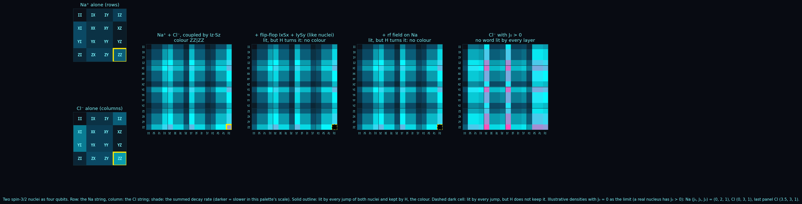

# The Nucleus as a Key

**Date:** 2026-10-27
**Authors:** Thomas Wicht, Claude (Opus 5.5)
**Status:** A reading (Tier 4) of results the sodium pages hold, with its arithmetic gated: the code's count and the pair sums (integer statements), the single-motion relation (exact in rationals); the noise figures are a statistic over 20000 draws, printed by the script and not a law; the two-nucleus verdicts restate [The Sodium Chain](THE_SODIUM_CHAIN.md) and the spin-lock section of [The Sodium Nucleus and Its Two Mirrors](THE_SODIUM_NUCLEUS_TWO_MIRRORS.md), indexed together as [F167](../docs/ANALYTICAL_FORMULAS.md#f167).
**Scripts:** [`sodium_key.py`](../simulations/sodium_key.py) (the code, the read-back, the motion), [`nacl_layers.py`](../simulations/nacl_layers.py) (two nuclei, each verdict read twice), [`sodium_layers.py`](../simulations/sodium_layers.py) (one nucleus, layer by layer).

The sodium page reads the quadrupolar relaxation of a spin 3/2 as dephasing by five Pauli strings, and the gallery draws it as stacked filters: every jump a transparent layer that lights the strings it anticommutes with and charges them its rate ([The Sodium Nucleus, Layer by Layer](../visualizations/README.md#the-sodium-nucleus-layer-by-layer)). Looked at long enough, the drawing reads like script. This page takes that as a reading: the three spectral densities of a nucleus are written into sixteen cells with redundancy, so the pattern is a key that can be checked, read back to the densities, and read back further to the motion around the nucleus, up to a narrowing that can be computed in advance.

<!-- STAGE 0 SWEEP RECORD (for us, not for the reader: hidden on GitHub, read by every session, agent and hook)

One survey agent swept the stores by name for four items: the filter reading of string dephasing, two spin-3/2 nuclei and their couplings, the rate table as a linear code read back, and the read-back of the densities to the motion under a Lorentzian. Two review agents then added what the sweep had missed.

- docs/ANALYTICAL_FORMULAS.md: F158 (the far kernel), F167 (index of the two sodium pages; coupled nuclei that keep each nucleus's outer/inner bit carry a ladder of centres), F169 (the colour law on Heisenberg graphs, not the nucleus). Nothing on the code or the motion. F124's resolution-limit reading treats bond recovery as an inverse problem with noise, the nearest precedent for a read-back.
- docs/proofs/: PROOF_PALINDROME_TWO_END_COUNT as the base; nothing on the other items.
- experiments/: THE_SODIUM_NUCLEUS_TWO_MIRRORS holds the filter rule (the rate of each string is twice the summed rate of the jumps it anticommutes with, the whole rate table), the far kernel empty with all three densities positive and Gamma0 at J0 = 0, the section "What a sodium measurement can read", which already uses the mean-rate identity c1 = (6J1 + 6J2)/2 as a check whose deviation says something outside the model is present (the identity is one of this page's five genuine relations), its open item on that identity as a consistency check, the spin-lock section (the central transition's part keeps both mirrors, the whole field breaks them at generic rates, in extreme narrowing the two-mirror map turns with the field, and the global-centre element E exists only at J0 = J2 = 0, q = 0, w = 3K2), the bright pairs mixing with a splitting while each pair's two rates sum to 2c2, extreme narrowing as equality up to order (w0 tau)^2, a one-Lorentzian closed form 2K1 minus K2, and the inequality J0 + J2 < 2J1 exactly for 0 < w0 tau < 1/sqrt 2. THE_SODIUM_CHAIN holds the Ising coupling (a J or dipolar coupling reduces to it between nuclei of different frequencies), the secular dipolar coupling of like nuclei with its sqrt 3 strings anticommuting with ZZ1ZZ2 while the central flip-flop and IXIX, IYIY behave otherwise, the lemma gated with residual exactly 0, and the lit span Q alone, empty once the J0 jumps are present. THE_PALINDROME_AS_A_COLOURING defines colours; it cites neither sodium page. No null result on these items.
- hypotheses/, reflections/: nothing. The OpenArcs registry: nothing on sodium. docs/GLOSSARY.md: nothing; its "Spectral filter" row is another object, a word kept apart. docs/CAUGHT_ERRORS.md: the sodium spin-1 rays entry, not these items. fw.Confirmations: nothing on NMR.
- The typed layer: Spin32QuadrupolarMirrorsClaim and SodiumChainMirrorLadderClaim in Core; SodiumTwoMirrorsWitness (a spin-lock gate, extreme narrowing) and SodiumChainWitness in Diagnostics. Neither reads a code or a motion back.
- visualizations/README.md: the sodium layers entry holds the filter reading; "Bridge Fingerprints" is another object, so the word fingerprint is kept out. The verifier simulations/sodium_two_mirrors.py gates the one-Lorentzian relation for J0 + J2 minus 2J1 in closed form.

Checked for adjacency: the chain's lit span at many nuclei is the colouring page's object on a product of subsystems; the sodium page's open item on the mean-rate identity and F124's inverse-problem reading are both about reading parameters back with noise and do not cite each other, and this page links the first; the spin-lock's turned map and the colouring page's colours on a circle are cited one way only.
-->

## One nucleus, two nuclei

One nucleus first, as the sodium page has it. In Souza et al.'s labelling the five jumps are ZZ, ZX, ZY, XI and YI at rates 3J₀/2, 3J₁/2, 3J₁/2, 3J₂/2, 3J₂/2, and at zero splitting and offset the sixteen two-qubit strings are the dissipator's eigenoperators, each decaying at twice the summed rate of the jumps it anticommutes with. A string lit by every jump and commuting with H is an element of [F158](../docs/proofs/PROOF_PALINDROME_TWO_END_COUNT.md)'s far kernel, a colour in the sense of [the palindrome as a colouring](THE_PALINDROME_AS_A_COLOURING.md). That is ZZ at J₀ = 0 and nothing at J₀ > 0, which under a Lorentzian density is every real nucleus (the gallery entry says so beside its figure).

Two nuclei multiply. A jump of one nucleus reads only that nucleus's letters, so a four-qubit string is lit by every jump exactly when each nucleus's half is lit by its own jumps: the lit strings of a pair are the products, ZZ⊗ZZ when both nuclei have J₀ = 0 and none as soon as one has J₀ > 0, as [The Sodium Chain](THE_SODIUM_CHAIN.md) states for any number of nuclei. What a coupling does is that page's and the sodium page's result, drawn here for Na⁺ and Cl⁻, both spins 3/2:

- the Ising coupling I_z·S_z keeps ZZ⊗ZZ, and between nuclei of different frequencies, such as ²³Na and ³⁵Cl, a secular dipolar or J coupling reduces to it;
- the full flip-flop I_xS_x + I_yS_y of like nuclei breaks it through its √3 strings, which anticommute with ZZ⊗ZZ (between Na and Cl it is non-secular and drawn only as the like-nuclei case);
- an rf field on one nucleus breaks it at generic rates; its central-transition part keeps both mirrors, and in extreme narrowing the sodium page's two-mirror map turns with the field (a turned element exists only at J₀ = J₂ = 0, so with J₀ > 0 there is no colour to turn).

The figure's densities are illustrative, with J₀ = 0 on both nuclei as the limit that lets a colour exist; the last panel gives Cl a monotone J₀ > J₁ > J₂, as a real nucleus has. Each verdict is read twice before it is drawn: the surviving strings, and the residual of S(ρ) = ZZZZ·ρᵀ against S·L·S⁻¹ = −L − 2σ entry by entry, which is exactly 0 where the colour survives and of order one where it does not.

## The key

At zero splitting and offset the rate vector of the sixteen strings is

  r = G·(J₀, J₁, J₂),

with G a 16 × 3 matrix of integers, the number of times each density's jumps light the string, times 3, and of rank 3. In coding terms G is a generator matrix and the remaining relations are parity checks over the reals; counting them is elementary linear algebra. Of the thirteen, one cell (II) is 0 in every nucleus, seven cells repeat another cell's rate, and five are genuine relations among the eight distinct non-zero rates. One of the five, r(XX) = (r(IZ) + r(ZI))/2, is the mean-rate identity the sodium page already uses as a model check in [What a sodium measurement can read](THE_SODIUM_NUCLEUS_TWO_MIRRORS.md#what-a-sodium-measurement-can-read), where a deviation says something outside the model is present; r(ZZ) = r(IZ) + r(ZI) is another. The other relations widen that one check to five.

Reading back is exact and unique: J₁ = r(IZ)/6, J₂ = r(ZI)/6, J₀ = r(IX)/3 − J₁. A measurement does not see sixteen independent cells, though: a coherence and its conjugate are one decay, so in principle it separates nine (three population rates, the central transition, the triple quantum, two satellite modes and two double-quantum modes; several of them only through multiple-quantum filtered experiments), still three numbers with six to spare. With 2% relative noise on each of the nine and each weighted by the inverse of its size, the textbook weighting for relative noise (J = (1, 0.6, 0.3), 20000 draws, rms relative error):

| read from | J₀ | J₁ | J₂ |
|---|---|---|---|
| three readings | 3.4% | 2.0% | 2.0% |
| nine readings, weighted | 1.8% | 1.3% | 1.8% |

A splitting ω_Q, which enters H as q·ZZ with q = ω_Q·√6/2, changes the bright cells: each bright pair mixes into the rates c₂ ± √(9J₂² − 4q²) (the satellites; the double quanta with J₁), as the sodium page derives, while the two rates of a pair still sum to 2c₂. In strings the pairs are {IX, ZX}, {IY, ZY}, {XI, XZ} and {YI, YZ}, and all four sums are the one number 6(J₀ + J₁ + J₂). So with a splitting the bright sector gives one number and the key survives because the dark cells are untouched: J₁ and J₂ from IZ and ZI as before, and J₀ = (pair sum)/6 − J₁ − J₂. An offset alone only turns a coherence into its partner of equal rate and changes no rate.

## Back to the motion

Under one Lorentzian density J(ω) = Aτ/(1 + ω²τ²), read at J_m = J(mω₀) as the sodium page does, with a = (ω₀τ)²,

  J₀/J₁ − 1 = a,   J₀/J₂ − 1 = 4a,   so   (J₀/J₂ − 1) = 4·(J₀/J₁ − 1).

The last relation is a check of its own, exact in rationals and broken by a sum of two Lorentzians (both gated). A key that breaks it beyond its measurement error does not come from one Lorentzian density: more than one motion, a single motion of another shape, or an ordered medium, where the sodium page notes the densities need not follow one curve. A key that keeps it does not thereby prove one motion. Where it holds, a gives ω₀τ, and with ω₀ known (the field times the nucleus's gyromagnetic ratio; the key gives only the product ω₀τ) τ follows, and J₀ = Aτ gives the strength A. The sodium page's inequality J₀ + J₂ < 2J₁, exactly for 0 < ω₀τ < 1/√2, its one-Lorentzian closed form 2K₁ − K₂ and the relation its verifier gates for J₀ + J₂ − 2J₁ belong to the same family.

The read-back narrows where the motion is fast against the field. At ω₀τ ≪ 1 the three densities are equal up to order (ω₀τ)², as the sodium page states for extreme narrowing, and only the product Aτ can be read: strength and motion can no longer be told apart. For sodium in water at room temperature in a 9.4 T magnet (τ of a few picoseconds) a is about 1·10⁻⁵, far below any measured precision. In a cold or viscous environment, where ω₀τ approaches 1, both come back.

So the key identifies the environment of a nucleus, its strength A and its motion τ, given the frequency, and not the element as such. The element enters through ω₀, by its gyromagnetic ratio, and through the quadrupole moment inside A: two nuclei with equal densities write the same key.

## What is new here, and what is not

Not new, and recalled rather than looked up where it is outside the repository: the filter rule and the far kernel of one nucleus (the sodium page); every verdict on two nuclei (the chain page and the spin-lock section); the mean-rate identity as a model check (the sodium page); reading measured relaxation rates back to spectral densities, and comparing J(0), J(ω₀) and J(2ω₀) against one Lorentzian, which is the practice of spectral-density mapping in NMR; that extreme narrowing leaves only Aτ; weighting a fit by the size of relative noise; and the linear algebra of the count.

What the page adds is the reading: the rate table seen as a redundant code, one model check widened to five with the count of which relations are trivial and which are not, the bright sector collapsing to one number under a splitting while the dark cells carry the key, the single-motion relation set beside the sodium page's own relations as a check, and the drawing that shows all of it. It is a reading and a tool, not a prediction: no sodium data were compared.

## Open

- Measured sodium rates against the five genuine checks and the single-motion relation, which is the sodium page's open item on the mean-rate identity, widened. The single-motion relation against one published data set: [Sodium in Agarose, Layer by Layer](SODIUM_IN_AGAROSE_LAYER_BY_LAYER.md); the five checks need individual coherence rates and remain open.
- The read-back with noise as an inverse problem, beside the resolution-limit reading of [F124](../docs/ANALYTICAL_FORMULAS.md); not joined.
